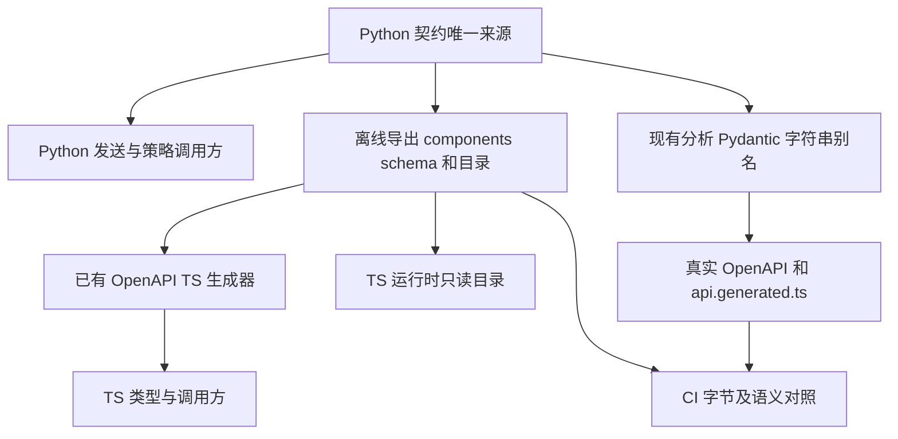

# Agent DataChannel 与分析错误码契约设计

> 已独立评审APPROVED R0，待用户确认、未实施。
> 以下新增文件、生成流程、测试和变异均为拟议，未实施、未运行。
> 当前事实冻结于 `fcc9d6ed519196383d3b929da3a2a4f8d11e5dad`。
> [TODO G3](https://github.com/sunpcm/EchoTalk/blob/fcc9d6ed519196383d3b929da3a2a4f8d11e5dad/TODO.md#L14-L25)
> 要求先设计、用户确认后实施；设计通过不解除该门禁。

## 1. 结论与范围

推荐以一个无配置、无 SDK、无网络和数据库副作用的 Python 契约模块为唯一人工维护来源，导出本地机器 schema，再用已有 `openapi-typescript` 工具派生 TypeScript。Python 调用方直接引用源定义，前端类型和运行时目录引用生成物，CI 检查生成字节及实际调用行为。

必须分别表达三种约束：Agent 发送端的九码安全白名单、接收端允许未知非空 code 的兼容形状、分析 API 的开放字符串/空值。诊断允许集合和重试策略是独立投影，不能由“所有已知码”自动替代。

本稿不改变消息字段、静态中文文案、发送与断连顺序、重试次数或退避、身份隔离、错误脱敏；不实施 I1 Provider 抽象或 B2 学习事件。真实 LiveKit、Provider、设备和滚动部署均未验证。

## 2. 当前清单的完整性与边界

以冻结提交的全部 Git tracked 文件为起点，排除路径任一段以 `.env` 开头的文件且不读取其字节，共 674 份文件。对其中 379 份 Python、TS/TSX、JS/MJS、HTML、Rust、Swift、Kotlin、Java、C/C++/Objective-C 源文件搜索下列发送、接收、RPC 和文本流入口；测试、E2E/Fake 和 scripts 单独分类，未用 TODO 的描述代替搜索。

```text
publish_data publishData useDataChannel DataReceived DataPacket data_received
send_text sendText sendData perform_rpc performRpc register_rpc registerRpc
sendChatMessage useChat register_text_stream_handler registerTextStreamHandler
streamText stream_text lk.chat
```

命中 61 行，58 行属于测试/夹具/工具，生产仅 3 行：`useDataChannel` 的 import、一次订阅调用和一次 `publish_data` 调用，落在下面两个文件。继而沿两个兼容包装、Mapper、插件构造和 orchestrator 调用链追读。当前发现 **1 种应用自有消息、1 个发送出口、1 个订阅出口**；没有发现应用自有上行消息、RPC 或文本流协议。该结论针对当前仓内应用源码，不枚举未入库的 SDK 内部消息，也不能替代新增调用时的门禁。

- 唯一发送：[error_delivery.py:49–58](https://github.com/sunpcm/EchoTalk/blob/fcc9d6ed519196383d3b929da3a2a4f8d11e5dad/backend/livekit_agent/error_delivery.py#L49-L58)。`agent.py` 的兼容包装和 orchestrator 默认发送器最终委托此出口：[agent.py:150](https://github.com/sunpcm/EchoTalk/blob/fcc9d6ed519196383d3b929da3a2a4f8d11e5dad/backend/livekit_agent/agent.py#L150)、[job_orchestrator.py:29](https://github.com/sunpcm/EchoTalk/blob/fcc9d6ed519196383d3b929da3a2a4f8d11e5dad/backend/livekit_agent/job_orchestrator.py#L29)。
- 唯一订阅：[ActiveConversation.tsx:65–91](https://github.com/sunpcm/EchoTalk/blob/fcc9d6ed519196383d3b929da3a2a4f8d11e5dad/apps/vite-app/src/components/conversation/ActiveConversation.tsx#L65-L91)。
- 分析错误另查全部 `AnalysisServiceError` / `AnalysisExecutionError` 构造、`last_error_code` 写入、`error_code` 透传/比较/清理及 worker。Python AST 找到两个生产构造点、两个测试构造点；结合赋值和兜底分支，生产固定码为 4 个，策略/日志已知目录为 5 个。详见 §4；原始逐行搜索和 AST 清单随本轮实施报告保存。

SDK 标准事件不归入上述自有消息数：字幕来自 `useVoiceAssistant` 与 `useTrackTranscription` 的 SDK segments，UI 内部 `ChatMessage` 是显示投影；后端 `conversation_item_added` 与 `ErrorEvent` 是 SDK 回调，分别进入转录持久化和错误分类。它们不等于应用发送了同名 JSON 消息。证据：[ChatSubtitles.tsx:27–70](https://github.com/sunpcm/EchoTalk/blob/fcc9d6ed519196383d3b929da3a2a4f8d11e5dad/apps/vite-app/src/components/conversation/ChatSubtitles.tsx#L27-L70)、[job_orchestrator.py:388–405](https://github.com/sunpcm/EchoTalk/blob/fcc9d6ed519196383d3b929da3a2a4f8d11e5dad/backend/livekit_agent/job_orchestrator.py#L388-L405)。`emotion_state` 随转录处理，不是第二种自有 DataChannel envelope。

## 3. 当前 DataChannel 契约

### 3.1 传输、字段与兼容

唯一 topic 为 `agent_error`，使用 `reliable=True`，JSON 以 `ensure_ascii=False` 构造。发送前必经安全 Mapper，实际 payload 精确包含以下三字段，没有 `session_id`、版本号、时间戳或 retryable：[发送与映射](https://github.com/sunpcm/EchoTalk/blob/fcc9d6ed519196383d3b929da3a2a4f8d11e5dad/backend/livekit_agent/error_delivery.py#L42-L58)。

- `type`：必有字符串，精确为 `agent_error`，接收端区分大小写；缺失、null、其他值拒绝。
- `code`：必有字符串。发送端仅输出 §3.2 九个码；接收端只要求 `trim()` 后非空，允许未知码，保留原字符串及首尾空白，不转换为 enum。
- `message`：必有字符串。发送端只使用码对应的安全静态中文文案，忽略调用方 raw message；接收端只要求 `trim()` 后非空，并原样返回，不在前端重新映射文案。

接收端要求三个字段都是 own property；非对象、null、数组、字段类型不符、空白串、JSON 解析异常返回 null，不抛出。额外字段允许但丢弃，解析结果只含 code/message。证据：[agentErrorMessage.ts:1–35](https://github.com/sunpcm/EchoTalk/blob/fcc9d6ed519196383d3b929da3a2a4f8d11e5dad/apps/vite-app/src/components/conversation/agentErrorMessage.ts#L1-L35)。`TextDecoder()` 未开启 fatal；某些坏字节可先替换为 Unicode 替换字符，不能声称任意非法 UTF-8 都被拒绝。现有畸形字节测试只证明其指定样本失败。

普通 publish Exception 被静态警告吞掉，之后仍 disconnect；disconnect 异常向上传播，publish 阶段取消不由该 `except Exception` 处理。没有应用 ACK、落库或收到后确认机制，`reliable=True` 不能据此宣称 UI 一定收到或恰好收到一次。[控制流](https://github.com/sunpcm/EchoTalk/blob/fcc9d6ed519196383d3b929da3a2a4f8d11e5dad/backend/livekit_agent/error_delivery.py#L53-L64)、[现有边界测试说明](https://github.com/sunpcm/EchoTalk/blob/fcc9d6ed519196383d3b929da3a2a4f8d11e5dad/backend/tests/test_error_delivery.py#L9-L18)。

### 3.2 九个发送码及全部安全文案

下列每项的固定文案和白名单均在 Mapper 中声明，不能从 Provider 异常正文派生：

- `ERR_CUSTOM_KEY_INVALID` → “自定义模式下 API Key 无效或未配置，请在设置页面检查密钥。”：[Mapper:31](https://github.com/sunpcm/EchoTalk/blob/fcc9d6ed519196383d3b929da3a2a4f8d11e5dad/backend/livekit_agent/error_mapper.py#L31)。凭据缺失/解密失败、Key 格式和 LLM model 空值都会进入此码：[凭据](https://github.com/sunpcm/EchoTalk/blob/fcc9d6ed519196383d3b929da3a2a4f8d11e5dad/backend/livekit_agent/credential_resolver.py#L83-L147)、[Key](https://github.com/sunpcm/EchoTalk/blob/fcc9d6ed519196383d3b929da3a2a4f8d11e5dad/backend/livekit_agent/plugin_factory.py#L59-L73)、[model](https://github.com/sunpcm/EchoTalk/blob/fcc9d6ed519196383d3b929da3a2a4f8d11e5dad/backend/livekit_agent/plugin_factory.py#L139-L143)。
- `ERR_UNSUPPORTED_STT_PROVIDER` → “不支持的 STT 提供商配置，请在设置页面选择有效的提供商。”：[Mapper:32](https://github.com/sunpcm/EchoTalk/blob/fcc9d6ed519196383d3b929da3a2a4f8d11e5dad/backend/livekit_agent/error_mapper.py#L32)、[生产:105](https://github.com/sunpcm/EchoTalk/blob/fcc9d6ed519196383d3b929da3a2a4f8d11e5dad/backend/livekit_agent/plugin_factory.py#L105)。
- `ERR_UNSUPPORTED_LLM_PROVIDER` → “不支持的 LLM 提供商配置，请在设置页面选择有效的提供商。”：[Mapper:33](https://github.com/sunpcm/EchoTalk/blob/fcc9d6ed519196383d3b929da3a2a4f8d11e5dad/backend/livekit_agent/error_mapper.py#L33)、[生产:133](https://github.com/sunpcm/EchoTalk/blob/fcc9d6ed519196383d3b929da3a2a4f8d11e5dad/backend/livekit_agent/plugin_factory.py#L133)。
- `ERR_UNSUPPORTED_TTS_PROVIDER` → “不支持的 TTS 提供商配置，请在设置页面选择有效的提供商。”：[Mapper:34](https://github.com/sunpcm/EchoTalk/blob/fcc9d6ed519196383d3b929da3a2a4f8d11e5dad/backend/livekit_agent/error_mapper.py#L34)、[生产:165](https://github.com/sunpcm/EchoTalk/blob/fcc9d6ed519196383d3b929da3a2a4f8d11e5dad/backend/livekit_agent/plugin_factory.py#L165)。
- `ERR_SYSTEM_CONFIG` → “系统配置错误，请稍后重试。”：[Mapper:35](https://github.com/sunpcm/EchoTalk/blob/fcc9d6ed519196383d3b929da3a2a4f8d11e5dad/backend/livekit_agent/error_mapper.py#L35)、[生产:197](https://github.com/sunpcm/EchoTalk/blob/fcc9d6ed519196383d3b929da3a2a4f8d11e5dad/backend/livekit_agent/plugin_factory.py#L197)。基础轨配置异常未在自定义轨 catch 中接收，不能据此说该分支已实测发送成功；共享出口允许该码。
- `ERR_SESSION_NOT_FOUND` → “无法找到您的会话配置，请重新登录后再试。”：[Mapper:36](https://github.com/sunpcm/EchoTalk/blob/fcc9d6ed519196383d3b929da3a2a4f8d11e5dad/backend/livekit_agent/error_mapper.py#L36)。配置查询异常与没有配置均发送该码：[agent.py:304–324](https://github.com/sunpcm/EchoTalk/blob/fcc9d6ed519196383d3b929da3a2a4f8d11e5dad/backend/livekit_agent/agent.py#L304-L324)。
- `ERR_CUSTOM_RUNTIME_AUTH` → “您的自定义 API Key 认证失败（HTTP 401/403），请检查密钥是否有效。”：[Mapper:37](https://github.com/sunpcm/EchoTalk/blob/fcc9d6ed519196383d3b929da3a2a4f8d11e5dad/backend/livekit_agent/error_mapper.py#L37)。只在自定义轨分类；typed `APIStatusError` 依据状态 401/403，普通 Exception 的 legacy 分支才检查文本线索：[分类:106–125](https://github.com/sunpcm/EchoTalk/blob/fcc9d6ed519196383d3b929da3a2a4f8d11e5dad/backend/livekit_agent/error_mapper.py#L106-L125)。
- `ERR_CUSTOM_RUNTIME` → “自定义 API 服务请求失败，请检查服务配置与网络连接。”：[Mapper:38](https://github.com/sunpcm/EchoTalk/blob/fcc9d6ed519196383d3b929da3a2a4f8d11e5dad/backend/livekit_agent/error_mapper.py#L38)。非认证且 `recoverable is False`；也用于自定义轨启动和 sink 故障：[分类:127–134](https://github.com/sunpcm/EchoTalk/blob/fcc9d6ed519196383d3b929da3a2a4f8d11e5dad/backend/livekit_agent/error_mapper.py#L127-L134)、[sink:103–122](https://github.com/sunpcm/EchoTalk/blob/fcc9d6ed519196383d3b929da3a2a4f8d11e5dad/backend/livekit_agent/job_orchestrator.py#L103-L122)。
- `ERR_SYSTEM_RUNTIME` → “语音管线启动失败，请稍后重试。”：[Mapper:39](https://github.com/sunpcm/EchoTalk/blob/fcc9d6ed519196383d3b929da3a2a4f8d11e5dad/backend/livekit_agent/error_mapper.py#L39)。基础轨启动/sink 故障及最终非法 fallback 的兜底：[启动:407–424](https://github.com/sunpcm/EchoTalk/blob/fcc9d6ed519196383d3b929da3a2a4f8d11e5dad/backend/livekit_agent/job_orchestrator.py#L407-L424)、[最终回退:72–82](https://github.com/sunpcm/EchoTalk/blob/fcc9d6ed519196383d3b929da3a2a4f8d11e5dad/backend/livekit_agent/error_mapper.py#L72-L82)。

`PluginInitError.code` 自身是开放 str；Agent 自定义插件 catch 先映射、发送出口再映射。未知 code 使用有效 fallback，fallback 也未知则落到 `ERR_SYSTEM_RUNTIME`，raw message 始终被静态消息替代。基础轨普通 SDK runtime error 分类返回 None，不能改成全部主动通知并断连。[异常定义](https://github.com/sunpcm/EchoTalk/blob/fcc9d6ed519196383d3b929da3a2a4f8d11e5dad/backend/livekit_agent/plugin_errors.py#L7-L13)、[调用映射](https://github.com/sunpcm/EchoTalk/blob/fcc9d6ed519196383d3b929da3a2a4f8d11e5dad/backend/livekit_agent/agent.py#L334-L348)。

### 3.3 收窄之后的权限、状态、诊断和 UI

解析成功还不等于接受：组件要求仍挂载、authenticated principal 与绑定身份相同、auth revision 一致；store 再核 sessionId/sessionGen、Room ownership 和连接状态。接受后递增 sessionGen、进入 ended 并保存 code/message。[组件门禁](https://github.com/sunpcm/EchoTalk/blob/fcc9d6ed519196383d3b929da3a2a4f8d11e5dad/apps/vite-app/src/components/conversation/ActiveConversation.tsx#L65-L88)、[store:1334–1363](https://github.com/sunpcm/EchoTalk/blob/fcc9d6ed519196383d3b929da3a2a4f8d11e5dad/apps/vite-app/src/store/conversationSlice.ts#L1334-L1363)、[内部状态事件](https://github.com/sunpcm/EchoTalk/blob/fcc9d6ed519196383d3b929da3a2a4f8d11e5dad/apps/vite-app/src/store/conversationState.ts#L481-L482)。内部 `agent_error` event 不另计一种 wire 消息。

UI 有 Agent 错误时停止评估轮询，显示固定标题“AI 服务启动失败”，直接显示收到的 message/code 和返回主页按钮，没有逐码 UI switch，也没有在此使用 `defaultMessage` 作为解析兜底。[UI 与轮询](https://github.com/sunpcm/EchoTalk/blob/fcc9d6ed519196383d3b929da3a2a4f8d11e5dad/apps/vite-app/src/components/conversation/EndedConversation.tsx#L29-L30)、[显示:63–89](https://github.com/sunpcm/EchoTalk/blob/fcc9d6ed519196383d3b929da3a2a4f8d11e5dad/apps/vite-app/src/components/conversation/EndedConversation.tsx#L63-L89)、[标题与未使用兜底声明](https://github.com/sunpcm/EchoTalk/blob/fcc9d6ed519196383d3b929da3a2a4f8d11e5dad/apps/vite-app/src/i18n/zh-CN.ts#L282-L286)。

前端诊断 `agent_error_received.agent_code` 仅允许 `ERR_CUSTOM_KEY_INVALID`、`ERR_SESSION_NOT_FOUND`、`ERR_CUSTOM_RUNTIME_AUTH`、`ERR_CUSTOM_RUNTIME`、`ERR_SYSTEM_RUNTIME` 五项。其余四个合法发送码和未知码均记 `unknown`；message 不记录。schema 统一来源时必须保留这个较小投影，不能顺手扩大记录范围。[五项集合](https://github.com/sunpcm/EchoTalk/blob/fcc9d6ed519196383d3b929da3a2a4f8d11e5dad/apps/vite-app/src/lib/diagnostics.ts#L33-L41)、[诊断回退](https://github.com/sunpcm/EchoTalk/blob/fcc9d6ed519196383d3b929da3a2a4f8d11e5dad/apps/vite-app/src/lib/diagnostics.ts#L193-L199)。

## 4. 当前分析 Job 错误全链

### 4.1 固定目录、生产与消费

当前稳定码目录五项，其中四项有生产赋值/返回点，一项仅有已知策略和消费。以下 retryable 描述需区分执行自动重试与 API 人工重试：

- `session_missing`：任务执行查不到 Session 时抛 `AnalysisExecutionError`，默认不可自动重试，最终 failed；人工重试也被固定集合排除。[生产:184](https://github.com/sunpcm/EchoTalk/blob/fcc9d6ed519196383d3b929da3a2a4f8d11e5dad/backend/services/analysis_jobs.py#L182-L184)、[默认参数](https://github.com/sunpcm/EchoTalk/blob/fcc9d6ed519196383d3b929da3a2a4f8d11e5dad/backend/services/analysis_jobs.py#L35-L41)。
- `no_user_transcript`：`analyze_session` 无用户转录返回 None，执行器转为默认不可自动重试错误；人工重试排除。[服务:100–102](https://github.com/sunpcm/EchoTalk/blob/fcc9d6ed519196383d3b929da3a2a4f8d11e5dad/backend/services/analysis_service.py#L100-L102)、[生产:186–190](https://github.com/sunpcm/EchoTalk/blob/fcc9d6ed519196383d3b929da3a2a4f8d11e5dad/backend/services/analysis_jobs.py#L186-L190)。
- `worker_timeout`：stale running 恢复时写入；attempt 未耗尽回 pending 且立即可领取，耗尽则 failed。该码不在人工不可重试集合内；stale 恢复不同于异常后的 5/30 秒退避。[两个赋值及日志](https://github.com/sunpcm/EchoTalk/blob/fcc9d6ed519196383d3b929da3a2a4f8d11e5dad/backend/services/analysis_jobs.py#L151-L169)。
- `analysis_failed`：未被两个已知异常类处理的 Exception 统一返回此码；持久化 message 只包含固定前缀和异常类名，不复制 raw 异常正文。自动重试用异常的 retryable 属性，缺失默认 True；不是仅凭这个 code 决定。[兜底:205–212](https://github.com/sunpcm/EchoTalk/blob/fcc9d6ed519196383d3b929da3a2a4f8d11e5dad/backend/services/analysis_jobs.py#L205-L212)、[自动重试:229–254](https://github.com/sunpcm/EchoTalk/blob/fcc9d6ed519196383d3b929da3a2a4f8d11e5dad/backend/services/analysis_jobs.py#L229-L254)。
- `analysis_unsupported`：人工不可重试集合、日志允许集合、前端特殊文案和 Fake/测试有该码；本次没有找到生产 `AnalysisServiceError` 构造或抛出此值的分支。不能写成“当前未启用发音 Provider 一定失败”：现有服务在该情况下跳过发音，继续独立语法分析。[策略:24–28](https://github.com/sunpcm/EchoTalk/blob/fcc9d6ed519196383d3b929da3a2a4f8d11e5dad/backend/services/analysis_jobs.py#L24-L28)、[服务:166–171](https://github.com/sunpcm/EchoTalk/blob/fcc9d6ed519196383d3b929da3a2a4f8d11e5dad/backend/services/analysis_service.py#L166-L171)、[UI:157–166](https://github.com/sunpcm/EchoTalk/blob/fcc9d6ed519196383d3b929da3a2a4f8d11e5dad/apps/vite-app/src/components/conversation/EndedConversation.tsx#L157-L166)。

`unknown_error` **仅是分析结构化日志的归一化兜底**，不由该日志函数写回 Job 或 API。五个允许码以外统一记此值；前端诊断的 `unknown` 与之也不是同一命名空间。[analysis_observability.py:24–47](https://github.com/sunpcm/EchoTalk/blob/fcc9d6ed519196383d3b929da3a2a4f8d11e5dad/backend/services/analysis_observability.py#L24-L47)、[记录:120–123](https://github.com/sunpcm/EchoTalk/blob/fcc9d6ed519196383d3b929da3a2a4f8d11e5dad/backend/services/analysis_observability.py#L120-L123)。

### 4.2 开放值、动态异常与旁路边界

`AnalysisExecutionError.code` 与 `AnalysisServiceError.code` 都接收 str，没有闭集校验；`_safe_error` 对这两类直接透传 code，message 仅截断到 1000 字符。任意注入值在这条分支理论上可落库并由 API 透传，不能把日志白名单等同于持久化脱敏或 API enum。[异常与透传](https://github.com/sunpcm/EchoTalk/blob/fcc9d6ed519196383d3b929da3a2a4f8d11e5dad/backend/services/analysis_jobs.py#L205-L212)、[服务异常定义](https://github.com/sunpcm/EchoTalk/blob/fcc9d6ed519196383d3b929da3a2a4f8d11e5dad/backend/services/analysis_service.py#L35-L41)。当前生产构造点只有上节两处 `AnalysisExecutionError`；没有证据表明现有 Provider 在生产构造任意外部 code。

普通 Provider/数据库等异常的 **类名** 出现在通用 last_error 文案、进程日志，公开 error_code 仍是 `analysis_failed`；不能把 `RuntimeError`、`ValueError` 或未来 SDK 异常类名列为当前分析错误码。[process_job 日志](https://github.com/sunpcm/EchoTalk/blob/fcc9d6ed519196383d3b929da3a2a4f8d11e5dad/backend/services/analysis_jobs.py#L263-L272)、[worker 退出日志](https://github.com/sunpcm/EchoTalk/blob/fcc9d6ed519196383d3b929da3a2a4f8d11e5dad/backend/workers/analysis_worker.py#L208)。类名集合随依赖变化，无需冻结为 wire enum。

同名或相邻字符串另有命名空间：分析路由的 HTTP 404 “分析任务不存在”与 409 “当前分析状态不可重试”是 detail，不是 Job code；TranscriptSink 的 failure_reason 是内部回调输入，orchestrator 按模式映射为 Agent runtime code；SDK recoverable/type/status 是分类元数据。它们不并入分析目录。[HTTP detail](https://github.com/sunpcm/EchoTalk/blob/fcc9d6ed519196383d3b929da3a2a4f8d11e5dad/backend/routers/sessions.py#L555-L561)、[sink callback](https://github.com/sunpcm/EchoTalk/blob/fcc9d6ed519196383d3b929da3a2a4f8d11e5dad/backend/livekit_agent/transcript_sink.py#L246-L282)、[SDK 分类输入](https://github.com/sunpcm/EchoTalk/blob/fcc9d6ed519196383d3b929da3a2a4f8d11e5dad/backend/livekit_agent/job_orchestrator.py#L168-L202)。

### 4.3 持久化、worker、API、前端和清理

1. 结束 active 会话时在同一事务创建唯一 pending Job；Job 的 last_error_code 为 nullable `String(64)`，last_error 为独立 nullable Text。[创建](https://github.com/sunpcm/EchoTalk/blob/fcc9d6ed519196383d3b929da3a2a4f8d11e5dad/backend/routers/sessions.py#L490-L494)、[模型](https://github.com/sunpcm/EchoTalk/blob/fcc9d6ed519196383d3b929da3a2a4f8d11e5dad/backend/models/analysis.py#L39-L52)。数据库长度不等于 Python/API 已校验的长度；不新增数据库 enum 或迁移。
2. worker 事务中先 recover_stale，再 `SKIP LOCKED` claim；claim 增加 attempt_count，清 finished_at/next_retry_at，**不清 last_error_code**。执行结果写入失败先回滚，再另一个事务记录 failure；普通取消/停机保持现有恢复路径。[worker:71–99](https://github.com/sunpcm/EchoTalk/blob/fcc9d6ed519196383d3b929da3a2a4f8d11e5dad/backend/workers/analysis_worker.py#L71-L99)、[claim 与转换](https://github.com/sunpcm/EchoTalk/blob/fcc9d6ed519196383d3b929da3a2a4f8d11e5dad/backend/services/analysis_jobs.py#L74-L83)、[事务边界](https://github.com/sunpcm/EchoTalk/blob/fcc9d6ed519196383d3b929da3a2a4f8d11e5dad/backend/services/analysis_jobs.py#L259-L272)。
3. 自动失败重试上限 3，退避 5/30 秒，依据异常 retryable 属性与 attempt_count。人工可重试 failed 中除三项不可重试码之外的值，或超时 running；该判定不同于异常的 retryable 属性。人工 retry 清两个错误字段，**不重置 attempt_count**。[常量](https://github.com/sunpcm/EchoTalk/blob/fcc9d6ed519196383d3b929da3a2a4f8d11e5dad/backend/services/analysis_jobs.py#L21-L28)、[retry 与判定](https://github.com/sunpcm/EchoTalk/blob/fcc9d6ed519196383d3b929da3a2a4f8d11e5dad/backend/services/analysis_jobs.py#L281-L305)。
4. 成功清 last_error_code/last_error；自动回 pending 或 stale 恢复时仍可有错误码。因此不能新增“pending/running 必须 error_code=null”的 schema 限制。[成功清理](https://github.com/sunpcm/EchoTalk/blob/fcc9d6ed519196383d3b929da3a2a4f8d11e5dad/backend/services/analysis_jobs.py#L193-L195)。
5. 两个 API 都 join Session 按 current_user 过滤；GET status 与 POST retry 共用序列化函数，error_code 原样取 Job，retryable 由 can_retry_job 算，不返回 last_error。[序列化与 GET 身份过滤](https://github.com/sunpcm/EchoTalk/blob/fcc9d6ed519196383d3b929da3a2a4f8d11e5dad/backend/routers/sessions.py#L499-L533)、[retry 身份过滤](https://github.com/sunpcm/EchoTalk/blob/fcc9d6ed519196383d3b929da3a2a4f8d11e5dad/backend/routers/sessions.py#L545-L563)。
6. Pydantic 字段为默认 None 的开放 str/null；OpenAPI 因默认值将 error_code 标为非 required，实际路由构造会带它。生成 TS 为可选 string/null；本地 facade 用 WithRequired 补 required，并另收窄 status。这是现状差异，不能偷偷统一。[Pydantic](https://github.com/sunpcm/EchoTalk/blob/fcc9d6ed519196383d3b929da3a2a4f8d11e5dad/backend/schemas/session.py#L95-L105)、[OpenAPI](https://github.com/sunpcm/EchoTalk/blob/fcc9d6ed519196383d3b929da3a2a4f8d11e5dad/backend/openapi.json#L18-L85)、[生成 TS](https://github.com/sunpcm/EchoTalk/blob/fcc9d6ed519196383d3b929da3a2a4f8d11e5dad/apps/vite-app/src/lib/api.generated.ts#L525-L542)、[facade](https://github.com/sunpcm/EchoTalk/blob/fcc9d6ed519196383d3b929da3a2a4f8d11e5dad/apps/vite-app/src/lib/api/sessions.ts#L57-L64)。
7. API 方法目前直接 `request<AnalysisStatusResponse>`，没有该响应专用的运行时 schema parser。store 在 failed 时保留 job，将 error 设为 `job.error_code ?? "analysis_failed"`；pending/running 清本地 error，成功清本地 error。[API 方法](https://github.com/sunpcm/EchoTalk/blob/fcc9d6ed519196383d3b929da3a2a4f8d11e5dad/apps/vite-app/src/lib/api/sessions.ts#L350-L368)、[store](https://github.com/sunpcm/EchoTalk/blob/fcc9d6ed519196383d3b929da3a2a4f8d11e5dad/apps/vite-app/src/store/assessment.ts#L107-L159)。这里前端 `analysis_failed` 兜底不证明服务端写入了此码。
8. UI 只为 analysis_unsupported 选择特殊失败文案，其余码用通用文案；按钮由 failed 且 API retryable 控制，不在前端重算码集合。轮询对 failed 停止，对 succeeded 读取结果；认证 revision/principal、页面生命周期和代际仍隔离旧响应。[UI](https://github.com/sunpcm/EchoTalk/blob/fcc9d6ed519196383d3b929da3a2a4f8d11e5dad/apps/vite-app/src/components/conversation/EndedConversation.tsx#L144-L169)、[轮询门禁与终态](https://github.com/sunpcm/EchoTalk/blob/fcc9d6ed519196383d3b929da3a2a4f8d11e5dad/apps/vite-app/src/hooks/usePollingAssessment.ts#L95-L129)。

### 4.4 测试与夹具值，不能冒认生产

- `analysis_unsupported`：后端测试显式构造 AnalysisServiceError；Fake 也按具名 session 前缀生成该值。这证明消费场景存在，不证明生产 Provider 抛出。[后端测试](https://github.com/sunpcm/EchoTalk/blob/fcc9d6ed519196383d3b929da3a2a4f8d11e5dad/backend/tests/test_analysis_jobs.py#L236-L242)、[Fake](https://github.com/sunpcm/EchoTalk/blob/fcc9d6ed519196383d3b929da3a2a4f8d11e5dad/apps/vite-app/e2e/fake-api.mjs#L962-L975)。
- `provider_injected_secret`：测试注入的任意码，检查日志归一化为 unknown_error；不证明数据库/API 已进行同样归一化。[注入和日志断言](https://github.com/sunpcm/EchoTalk/blob/fcc9d6ed519196383d3b929da3a2a4f8d11e5dad/backend/tests/test_analysis_observability.py#L372-L387)。
- `timeout`：前端轮询失败夹具值，不是当前生产 worker_timeout 的别名。[前端测试:297](https://github.com/sunpcm/EchoTalk/blob/fcc9d6ed519196383d3b929da3a2a4f8d11e5dad/apps/vite-app/src/hooks/usePollingAssessment.test.tsx#L297)。
- `UNKNOWN_PROVIDER_CODE`、`CODE`、`Agent_Error`、空白及各类非字符串：Agent parser 的兼容/非法输入样本，不加入九码目录。[parser 测试](https://github.com/sunpcm/EchoTalk/blob/fcc9d6ed519196383d3b929da3a2a4f8d11e5dad/apps/vite-app/src/components/conversation/agentErrorMessage.test.ts#L29-L70)。
- Fake 的 analysis_failed、null 和人工 retry 响应是测试投影，不能用 Fake 简化的状态转换倒推数据库规则。[Fake retry](https://github.com/sunpcm/EchoTalk/blob/fcc9d6ed519196383d3b929da3a2a4f8d11e5dad/apps/vite-app/e2e/fake-api.mjs#L983-L995)。

## 5. 推荐方案：Python 唯一来源，本地 schema 与 TS 派生（拟议、未实施）

### 5.1 来源和产物

人工事实源拟放 `backend/agent_analysis_contract.py`：只依赖标准库及已有 Pydantic 2，不导入 Agent SDK、settings、dotenv、数据库或 main.app。声明不可变九码/安全文案目录、五项 Agent 诊断投影、五项分析已知目录及其“当前生产/仅策略”说明、三项人工不可重试投影、两种日志兜底，并声明消息模型。重试次数、退避和执行状态机仍在 analysis_jobs，不迁入通用 schema。

Python 模块中的“已知码 enum”用于目录与自有固定常量引用，不作为开放输入的强制类型转换。`AnalysisPublicErrorCode` 保持 str/null 语义；AnalysisStatusResponse 引用其字符串别名，保留默认 None、required 差异和所有其他字段。未知的 typed error code 仍沿现有路径处理，不能因导入 enum 而提前抛 ValueError。

机器产物拟放 `apps/vite-app/src/lib/agent-analysis.contract.generated.json`，沿用已有 Provider 元数据导出到前端的模式。使用 OpenAPI 3.1 **仅 components 的容器**，paths 为空，组件内部为 JSON Schema；它描述非 HTTP 消息，不虚构 HTTP operation，不合并进真实 main.app 的路由清单。这样可直接复用现有 `generate-api-types.mjs --schema … --output …`，不另建通用 schema 编译器。

容器包含 AgentErrorReceived、AgentErrorProduced、KnownAgentErrorCode、DiagnosticAgentErrorCode、KnownAnalysisErrorCode 和 AnalysisPublicErrorCode 组件；`x-echotalk-contract` 为受版本约束的生成元数据，记录 topic/reliable、静态安全文案、诊断/人工重试投影及字符串判定配置。它不是发送到 Room 的 payload。schema 产物版本从 1 起，只控制生成工具兼容，不新增 wire version 字段。

AgentErrorReceived 的 code/message 仍为严格字符串、允许额外字段；AgentErrorProduced 为三字段且 code 为九项已知目录，禁止多余字段。安全文案的逐码配对由同源 builder 和契约测试检查，不能把“形状 schema 通过”当作已经脱敏。接收端非空条件必须精确保留 ECMAScript trim 后非空且返回原值；不得用 Python strip 或不同正则引擎默认为跨语言等价。Python 不接收此消息，接收适配器保留原 TS 判定，并用 §7 的样本对照锁定语义。

TS 产物拟为 `apps/vite-app/src/lib/agentAnalysis.generated.ts`；前端直接导入生成类型和 JSON 中需要的目录投影，消费处用窄类型 facade 连接，避免复制字面量集合。现有 parser 保留输入 Uint8Array、返回 code/message 或 null 的签名和控制流，只替换其类型来源；未知码不被 KnownAgentErrorCode 阻断。分析 API 类型仍从真实 api.generated.ts 派生，不以新组件替代整个 AnalysisStatusResponse。

该选择复用已有 Python→JSON Provider 导出和已有 OpenAPI→TS 工具；后端已经依赖 Pydantic，前端已锁定 openapi-typescript，不需要新运行时依赖。代价是多一份受控生成 JSON/TS，以及对非 HTTP components 容器的明确说明。纯 JSON 作为人工源更语言中立，但本仓会另需维护 Python 绑定生成器；两端手写 enum 则继续漂移。当前只有一种消息，暂不增加通用运行时 validator、shared-core 或独立契约服务。

现有工具依据：[Provider 导出来源及落点](https://github.com/sunpcm/EchoTalk/blob/fcc9d6ed519196383d3b929da3a2a4f8d11e5dad/backend/export_provider_metadata.py#L16-L20)、[目录导出](https://github.com/sunpcm/EchoTalk/blob/fcc9d6ed519196383d3b929da3a2a4f8d11e5dad/backend/export_provider_metadata.py#L80-L129)、[TS 本地 schema 与生成检查](https://github.com/sunpcm/EchoTalk/blob/fcc9d6ed519196383d3b929da3a2a4f8d11e5dad/apps/vite-app/scripts/generate-api-types.mjs#L99-L173)、[既有依赖](https://github.com/sunpcm/EchoTalk/blob/fcc9d6ed519196383d3b929da3a2a4f8d11e5dad/backend/pyproject.toml#L8)。

复用边界（P2）：现有 `GENERATED_BANNER` 固定写 `backend/openapi.json` 和 `pnpm generate:api-types`，即使传入自定义 schema/output，生成头仍指旧入口。[固定模板](https://github.com/sunpcm/EchoTalk/blob/fcc9d6ed519196383d3b929da3a2a4f8d11e5dad/apps/vite-app/scripts/generate-api-types.mjs#L20-L25)、[拼接位置](https://github.com/sunpcm/EchoTalk/blob/fcc9d6ed519196383d3b929da3a2a4f8d11e5dad/apps/vite-app/scripts/generate-api-types.mjs#L119-L129)。未来只为新 schema 入口提供正确的生成头来源及再生成指令，来源使用稳定仓内相对路径；原默认调用的全部输出字节和 schema→AST 生成算法不变。将默认输出字节回归、自定义入口的生成头/指令与 --check 一致性纳入生成器回归测试，不能因为 toy 生成成功就省略这项工作。本轮不改该脚本。

工具可行性证据来自 Harness 转交：Harness 在自有私有合成空 paths/components 容器中调用现有 CLI，生成与 --check 均 exit0，且确认生成头仍引用旧源。实施方没有运行该 toy；它仅证明现有工具接受此类容器，不是 G3 schema 实现、实际契约测试或未来生成器回归已经完成。

### 5.2 拟议文件职责与生成流

以下全部为未来实施路径，当前不创建、不修改：

- `backend/agent_analysis_contract.py`：唯一可手改契约定义、不可变目录、Pydantic 形状和安全构造所需元数据；不搬移 SDK 错误分类逻辑。
- `backend/export_agent_analysis_contract.py`：离线导出上述 components 容器；支持输出路径与只读 --check，检查元数据版本及支持的 schema 语法，失败不写旧产物。
- `apps/vite-app/src/lib/agent-analysis.contract.generated.json`、`agentAnalysis.generated.ts`：生成物，禁止手改；JSON 兼作 TS 运行时只读目录来源，不维护第二份手写数组。
- `backend/livekit_agent/error_mapper.py`、`error_delivery.py`、`plugin_factory.py`、`credential_resolver.py`：引用同源已知码/消息，不改原始输入回退、异常分类和发送顺序；两个兼容包装保持原签名。
- `backend/services/analysis_jobs.py`、`analysis_observability.py`、`backend/schemas/session.py`：仅引用适用目录/字符串别名；持久化开放值、自动/人工重试和日志归一化各守原边界。
- `apps/vite-app/src/components/conversation/agentErrorMessage.ts`、`src/lib/diagnostics.ts`、评估 UI：消费生成类型和各自投影，保留原解析/五项诊断/文案/按钮行为。是否需要极小 facade 在实施时按真实导入复用决定，不预建共享层。
- 对应 backend tests、前端 parser/diagnostics/assessment 测试及脚本测试：补 §7 契约覆盖；若共享 lib/api 新增导出、解析或校验能力，必须同轮补 `src/lib/api.test.ts`，不能只靠组件用例。
- `apps/vite-app/package.json` 与现有 CI：未来增加离线 generate/check 入口和门禁；现有 API 类型生成脚本优先直接使用参数。仅适配新入口的生成头/再生成指令，原默认输出字节及生成算法保全，补对应生成器回归。



未来顺序：先执行 Python 导出，再用既有 Node 生成器产生 TS，最后运行所有 --check、契约测试、lint/typecheck 与三树。CI 不在 --check 中修复/覆盖产物，也不以下载或缓存产物替代重建。

确定性要求：对象键和目录按明确排序、UTF-8、LF、单一末尾换行；无时间戳、绝对路径、随机值、环境值或网络引用。Pydantic 输出的 `$defs` 统一为本地 components 引用，名称稳定，严禁 remote `$ref`；相同源在两个空临时输出目录生成字节相同。沿用隔离子进程、纯合成环境、阻断 DNS/socket 的已有导出方式，不读取真实配置或凭据。[现有隔离导出环境](https://github.com/sunpcm/EchoTalk/blob/fcc9d6ed519196383d3b929da3a2a4f8d11e5dad/backend/export_provider_metadata.py#L61-L77)、[确定序列化](https://github.com/sunpcm/EchoTalk/blob/fcc9d6ed519196383d3b929da3a2a4f8d11e5dad/backend/export_provider_metadata.py#L132-L141)。

### 5.3 漂移和失败门禁

1. Python exporter --check 在内存重建 schema/目录并逐字节比较；缺文件、旧产物、消息码与文案非一一对应、投影含未知码、重复值、版本不支持均退出非零，旧文件保全。
2. exporter 对生成 schema 做递归支持集检查：仅允许本轮模型所用的 type、const、enum、properties、required、additionalProperties、本地 $ref、anyOf/oneOf、title/description/default 和显式声明的字符串约束；仅支持声明的元数据字段。新增关键词、外部引用、未解析引用、不支持容器版本均失败，不静默省略约束。对象 properties 的业务字段名不能误按 schema 关键词检查。依赖升级新增 schema 特性时先审查再扩支持集。
3. 既有 TS 生成器 --check 检查新 TS 产物过期；同时回归默认调用输出字节未变、新入口生成头与再生成指令指向正确 schema/输出。该工具本身不是运行时验证器，不能单靠 TS 成功证明非空、额外字段投影或安全文案。运行时契约样本、producer 的精确 JSON/消息配对和脱敏断言必须另外执行。
4. `AnalysisStatusResponse.error_code` 的真实 OpenAPI 与新 AnalysisPublicErrorCode 做语义对照：可接收开放 string/null，无 enum/maxLength 新限制；保留原 default/required 差异，API 不多返回 last_error。既有 `export_openapi.py --check` 和 API TS --check 照常，不能让新 schema 成为第二个可手改的 HTTP 模型。
5. 类型检查确认调用方导入生成类型，测试对比实际 mapper/诊断/人工重试集合与同源投影；限定目标文件的 AST/导入规则禁止重新声明整份手写目录。接收适配器测试按生成 schema 的 required/properties 枚举缺字段、null、错误类型与额外字段样本，再与实际 parser 对照；改变 required 或字段约束却不更新 parser 必须失败。另保留独立手写的旧格式兼容样本，避免源定义和生成测试一起错误收紧。字符串比较的 UI 分支与异常生成点也要有行为断言，不能只检查导入存在。
6. 所有新增共享 API 能力同轮契约测试，服务端先落库再失败的路径做事务/脱敏检查；不靠 schema 关闭身份隔离或吞掉未知错误。现有五码日志投影和 Agent 五码诊断投影分别核对，不能互代。

现有 CI 已分别检查 HTTP schema 与 TS 生成物，本方案在对应作业增加门禁，不创建服务：[前端门禁](https://github.com/sunpcm/EchoTalk/blob/fcc9d6ed519196383d3b929da3a2a4f8d11e5dad/.github/workflows/ci.yml#L35-L41)、[后端导出门禁](https://github.com/sunpcm/EchoTalk/blob/fcc9d6ed519196383d3b929da3a2a4f8d11e5dad/.github/workflows/ci.yml#L128-L133)。

## 6. 兼容、开放值及待裁定事项

首次实施应是定义和引用收拢，旧 sender→新 receiver、新 sender→旧 receiver 都保持三字段和原 code/message。未知消息 type/畸形字段继续忽略，已知 type 中的新非空 code 继续被旧 receiver 接受；额外字段继续丢弃。诊断仍把未允许值折叠，分析 UI 用通用失败文案且尊重 API retryable，不因未知 code 自动重试或判成功。

新增码必须先明确它是稳定公开语义还是内部诊断，再补源目录、静态安全消息、投影选择和兼容测试。新增 Agent code 不自动放进前端诊断。新增分析 code 不能自动进不可重试集合；自动重试的异常属性与人工重试策略分别审核。已有已知码不改名/复用；数据库历史值不批量迁移，删除前先证明无活动生产者和历史消费依赖。

新增可选字段不改变本轮三字段实际输出；先验证旧 consumer 忽略行为，再以另轮确认具体语义。新增必填字段、改 type/topic、把未知码拒绝、增加 wire version 或改变消息语义，均属于破坏性变化，应另定 topic/兼容窗口并先用户确认，不能依赖“前后端同时发布”。本轮不拟议 ACK、自动重连或额外重试。

为何不把所有 Provider/诊断字符串做闭集：异常类名和外部状态随 SDK/Provider 变化；typed 分析错误 code 当前可透传开放值；前端 Agent parser 明确测试允许未知码。闭集会改变失败接收、历史数据和滚动升级行为，而且不能单独实现脱敏。闭集只用于应用自有的已知目录/安全发送集合，公开开放字段、日志归一化和业务策略分别表达。

待用户确认：是否采用上述 Python 唯一来源与 components 容器方案；确认后另开实施范围和验收，不以设计评审代替用户实现授权。以下观察不阻塞这份保行为设计，若要改变需独立裁定：

- typed 分析异常的任意 code/截断 message 目前不等于脱敏；现有日志 canary 测试未证明数据库/API 安全。未来引入真实 Provider 前应明确哪些稳定公开码/安全消息可以构造该异常，不能直接转发 Provider 正文。本轮不擅自改成闭集或归一化持久化值。
- Agent topic 和 JSON 形状不证明发送者身份；当前回调只取 payload，核的是本地 Room/auth ownership，没有显式校验发送 participant 是否 Agent。SDK/Room 的发布权限与真实攻击面未在本轮验证，不能宣称端到端已认证；增加发送者门禁需另核权限契约。
- 严格 UTF-8、长度限制、统一 schema required、扩大诊断允许集合、人工重试 attempt_count 重置，都可能改变行为；均不在本轮默认方案中。

## 7. 未来测试与变异矩阵（计划，未运行）

以下是设计验收建议，不是已经执行的测试，也不预报新增测试数或 CI 成功：

- 生成：两次隔离导出和 Node 生成字节一致；默认入口输出逐字节回归，新入口的生成头/再生成命令准确且与 --check 一致；--check 对缺失、过期、非法元数据、远程/悬空引用、不支持 schema 关键词和版本必须非零且不写旧产物。测试从独立期望值检查九码、五码诊断、五项分析及三项人工不可重试，不能只拿生成结果与自身比较。
- Agent producer：九码逐项核精确三字段、逐码安全中文配对、topic/reliable；恶意 code/message/session canary 不入 payload/log；未知 code/fallback 的两级回退；普通 publish 失败后断连、取消和断连异常边界；两个兼容包装亲调出口而非 mock 掉出口。
- Agent receiver：已知/未知非空 code、保留首尾空白、额外字段丢弃、own 字段、缺失/null/数组/错误类型/空白/错误 type、畸形 JSON；BOM/Unicode 空白与坏 UTF-8 的现有替换行为单列。不要只测 TypeScript 类型。
- 接收到 UI：原样安全 message/code、固定标题；错误后停评估轮询；卸载、旧 auth revision/principal、旧 sessionId/sessionGen、失去 Room ownership 均不能写状态或诊断。诊断覆盖九码，明确仅五项保留、四项及未知变 unknown。
- 分析执行/落库：四个生产固定分支、policy-only analysis_unsupported、未知 typed code、普通 Provider 异常类名与正文 canary、自动 retryable 属性真假/缺失；claim、不足/耗尽 attempt、5/30 秒与 stale 立即恢复、成功及人工 retry 清理、claim 保留旧码、人工不重置次数、事务回滚后记录失败。
- 分析 HTTP/前端：真实开放 string/null 与 schema optional/facade required 差异、未知码通用 UI、unsupported 专有 UI、retryable 按 API 按钮；跨用户 GET/retry、旧代际响应不写、未授权不读；last_error 不在响应。若增 lib/api 解析器或 helper，必须直接对其运行时输入输出补契约用例。
- 有效变异目标：移除 mapper 的消息替换应命中 canary/精确文案；将前端 receiver code 改闭集应命中未知码接受断言；把诊断集合扩为九码应命中四项归 unknown；移除非重试码或清理字段应命中 retry/落库断言；闭合 API enum 应命中未知值与 schema 对照；过期生成物/不支持关键词应命中生成门禁。每个变异要求实际目标断言失败，解析错误或全局 timeout 不算有效。

所有变异只在执行者自有临时副本，备份并 finally 逐字节恢复，正式 lane 不变异。未来实施完成后再由独立评审运行完整 Vitest、双浏览器 Playwright、backend pytest 和相关门禁；本设计轮按既定分工由 Harness 亲跑，实施方没有执行三树或服务。
