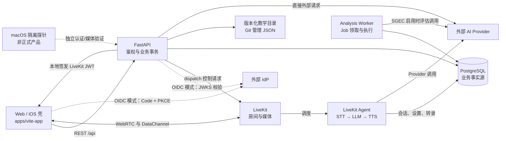
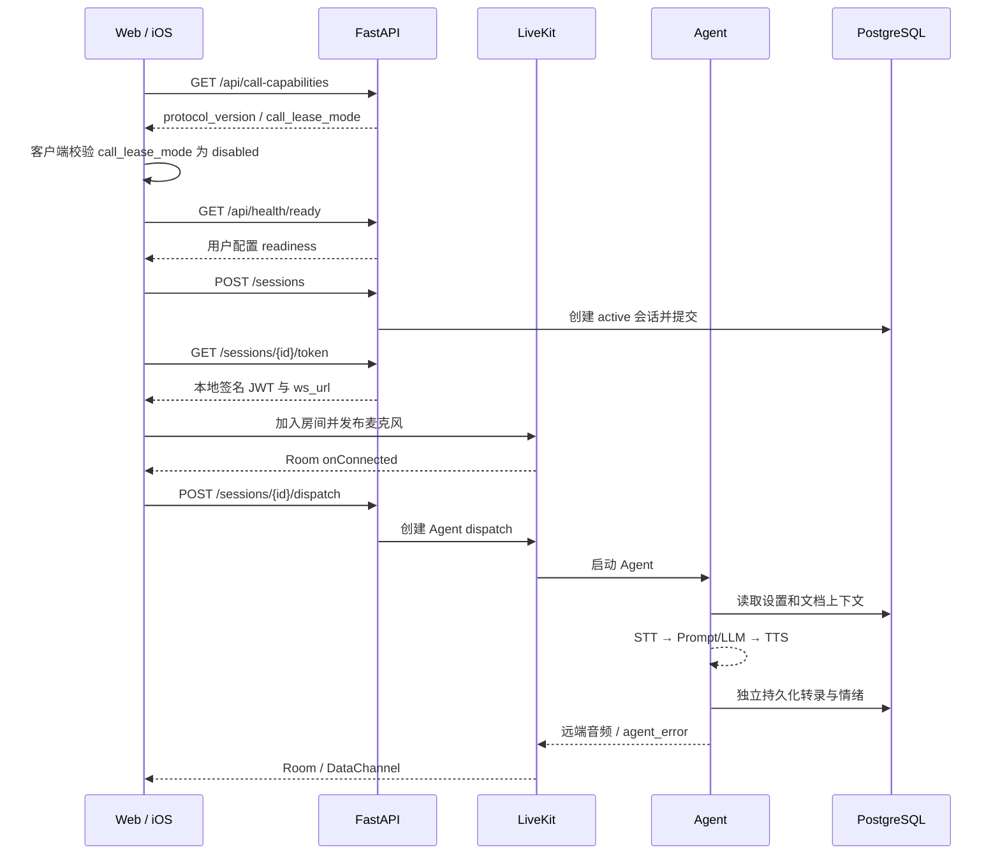
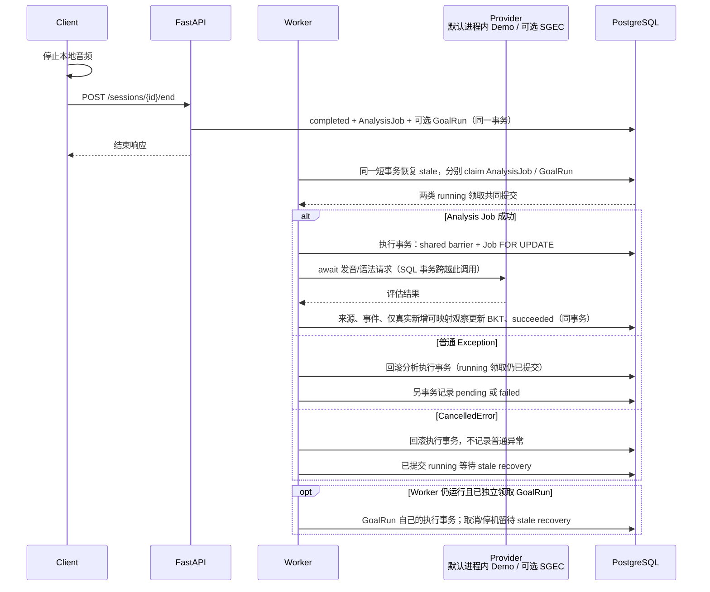

# EchoTalk 系统架构

> 本文于 2026-11-21 依据源码核验基线 `02242fe`（候选工作树）重核，描述当前实现的职责、数据所有权和
> 事务边界。主线、合入与验收进度统一见 [TODO](../TODO.md)；本文不维护第二套进度。
> 代码存在、自动化通过、真实外部服务和设备验收是不同证据，不能互相替代。

## 1. 架构结论

EchoTalk 以 Vite React 为唯一产品 UI，FastAPI 承载业务 API，LiveKit 负责实时房间，
Agent 和 Analysis Worker 是独立进程。PostgreSQL 保存用户业务事实；教学目录是随代码发布的只读目录，
不是用户数据库。当前运行链没有 Redis、Celery 或 Chroma。

主要由源码确认的边界见 [`routers/sessions.py`](../backend/routers/sessions.py)、
[`workers/analysis_worker.py`](../backend/workers/analysis_worker.py)、
[`livekit_agent/agent.py`](../backend/livekit_agent/agent.py) 与 [`docker-compose.yml`](../docker-compose.yml)。
业务事务留在 API 单体中；实时媒体交给 LiveKit，结束后的持久化分析交给 PostgreSQL Job。

## 2. 能力边界

| 能力     | 当前结构事实                                                                                 |
| -------- | -------------------------------------------------------------------------------------------- |
| Web      | `apps/vite-app` 是产品前端；用 Zustand 的 `appView` 切换顶层视图，没有以 Router 承担业务页面 |
| iOS      | Capacitor 工程和共享 UI；原生生命周期门禁与音轨中断处理位于共享客户端及平台适配层            |
| macOS    | `tools/macos-m1-native-probe` 是独立 Tauri 探针，验证认证和隔离媒体，不是正式产品客户端      |
| API      | FastAPI + async SQLAlchemy；请求会话正常成功后提交，异常回滚                                 |
| 实时语音 | 客户端取 Token、加入房间，再请求 Agent dispatch；媒体由 LiveKit 承担                         |
| 分析     | 结束事务创建 Job 与可选 Goal Run；Worker 分别领取执行，失败可有限重试                        |
| 学习事实 | B2 成功批次写追加事件，并仅依据真实新观察更新受历史证明约束的 BKT 状态                       |
| goals    | 版本化目录、会话快照、执行记录与结果存 PostgreSQL；规则判定由 Worker 执行                    |
| 教学目录 | `backend/data/teaching_materials.json` 与代码版本绑定，提供推荐和目标定义                    |
| 通话占用 | Cloud 原语和 controller 已有；共享客户端拒绝非 `disabled`，该模式尚未接通产品启动            |

静态结构不能推出已部署、已真机验收或已支持多端并发。具体功能状态只查 [TODO](../TODO.md)。

## 3. 运行时与职责

### 3.1 前端与共享启动

- `conversationStartup.ts` 先检查原生 lifecycle 就绪，再做 call capabilities、readiness、创建会话和取
  Token；创建成功而后续本地启动失败时，会尽力结束已创建会话，失败留给用户显式处理。
- `RoomSession` 绑定 `sessionId` 与 `sessionGen`，持有 Room 和生命周期资源；Room 的 `onConnected`
  只提交一次 Agent dispatch，该回调不额外证明麦克风已完成发布。旧回调、身份变化和卸载后的迟到结果
  按归属隔离。
- `useSessionGoalsQuery` 以精确 principal、认证 revision 与会话 ID 绑定只读轮询；结果迟到不能覆盖
  新会话。客户端结束动作先停止本地音频，再等待服务端结束响应。
- `lib/auth.ts` 实现浏览器 OIDC Authorization Code + PKCE 和显式 dev Token。OIDC 状态在浏览器
  `sessionStorage`，流程使用整页重定向；401 仅让匹配的认证 revision 失效。
- `platform/` 统一平台探测、API/LiveKit 地址与 Web/native lifecycle。原生 API origin 和 WSS 必须满足
  构建配置；Web 默认同源、原生默认直连配置地址。

客户端读取后端 capabilities；当前共享启动在 `call_lease_mode !== "disabled"` 时关闭本次启动。
[`CROSS_PLATFORM_CALL_LEASE.md`](./CROSS_PLATFORM_CALL_LEASE.md) 中的 Cloud 协议与
[`callLeaseController.ts`](../apps/vite-app/src/lib/callLeaseController.ts) 是独立原语，不能据此宣称
共享产品启动、恢复或 UI 已接通 Cloud 占用。

### 3.2 FastAPI

路由负责鉴权、输入输出和流程编排。`disabled` 模式的结束流程由 `get_db()` 在成功返回后提交；
Cloud 模式的结束流程在路由中显式提交。Worker 使用独立 session 和执行/失败事务。不能把这些路径
概括为所有动作处于同一事务。

| 模块     | 主要职责                                                | 源码                                                                                |
| -------- | ------------------------------------------------------- | ----------------------------------------------------------------------------------- |
| 健康检查 | liveness、用户配置 readiness、共享 PostgreSQL readiness | [`main.py`](../backend/main.py)                                                     |
| 会话     | 创建、活动记录、Token、dispatch、结束与分析重试         | [`routers/sessions.py`](../backend/routers/sessions.py)                             |
| 设置     | Provider 配置与加密 API Key                             | [`routers/user.py`](../backend/routers/user.py)                                     |
| 导出     | 本人结构化数据一致快照                                  | [`services/user_data_export.py`](../backend/services/user_data_export.py)           |
| 删除     | 本人业务数据整账号删除                                  | [`services/user_account_deletion.py`](../backend/services/user_account_deletion.py) |
| 评估     | 发音、语法、学习事件和 BKT                              | [`services/analysis_service.py`](../backend/services/analysis_service.py)           |

已挂载的路由清单见 [`main.py`](../backend/main.py)，本文不复制完整请求 schema。OIDC 的 issuer、
audience、JWKS 校验在 [`auth.py`](../backend/auth.py)，用户映射在
[`dependencies.py`](../backend/dependencies.py)。

### 3.3 LiveKit Agent

Agent 通过房间名中的会话 ID 读取设置与 DocTalk 上下文，根据 `is_custom_mode` 选用系统 Provider 或
用户 BYOK；自定义轨初始化失败通过 `agent_error` 通知客户端并断开，不静默换用系统密钥。
`livekit_agent.agent.EchoTalkAgent` 在用户轮次完成时做情绪分析，再选择 Prompt；转录进入
`TranscriptSink`，由 [`transcript_service.py`](../backend/services/transcript_service.py) 独立持久化。
普通持久化失败与最终不可恢复的 sink 故障不同：生产编排器将 `on_failure` 接到安全错误通知并终止会话；
队列满或最终重试耗尽会使对应通话失败，不能把转录失败一律视为不影响会话。

官方入口是 `python -m livekit_agent start` 或 `python -m livekit_agent dev`。API 认证与 Agent
Provider 配置走不同路径；Agent
仍与 API 共享数据库模型和凭据 keyring。当前 compose 中 Agent 使用 `agent` 依赖组，Worker 使用
`api` 组，见 [`backend/pyproject.toml`](../backend/pyproject.toml)。

### 3.4 Analysis Worker

[`workers/analysis_worker.py`](../backend/workers/analysis_worker.py) 每次在同一短领取事务中恢复陈旧
Job/Run，并分别用 `FOR UPDATE SKIP LOCKED` 领取至多一个 Analysis Job 和一个 Goal Run。领取提交后，
`process_job` 与 `process_goal_run` 各自开启执行事务。停机优先停止新领取；尚未完成的执行在宽限后
取消，已经提交的 `running` 状态由后续 stale recovery 处理。

## 4. 数据所有权与事务边界

PostgreSQL 含用户身份映射、会话、转录、设置、评估、学习事件、知识状态和 goals；Alembic 管理 schema，
应用启动不自动迁移。加密 Key 的业务密文和 key version 属于用户设置，加密 material 在独立配置中。
LiveKit 是房间和媒体的实时运行时，不保存 EchoTalk 的业务成功判据。主 compose 定义
`echotalk-postgres` 和命名卷 `postgres-data`，API、Agent、Worker 通过 `DATABASE_URL` 连接该实例；
这提供单机持久化配置，不等于已验收的备份、告警或灾备。

| 写入/动作                            | 事实所有者      | 提交或回滚边界                                                    |
| ------------------------------------ | --------------- | ----------------------------------------------------------------- |
| 用户、设置、会话与 DocTalk 上下文    | PostgreSQL      | 路由调用方的请求事务；显式提交处独立提交                          |
| LiveKit 房间、参与者与媒体           | LiveKit         | 实时服务状态；API 数据库回滚不能撤销已建立的媒体                  |
| 转录                                 | PostgreSQL      | Agent sink 独立提交；满队列/最终耗尽通过故障回调通知并断开        |
| 结束会话、初建 Analysis Job/Goal Run | PostgreSQL      | 同一结束事务：完成状态、Job、可选目标运行一起提交                 |
| Job/Run 领取与 stale 恢复            | PostgreSQL      | 同一短领取事务分别领取两类，共同提交；`running` 留给执行或恢复    |
| 分析来源、学习事件、BKT 与 Job 成功  | PostgreSQL      | 成功执行事务；执行内 `await` 跨 Provider 请求，外部副作用不能回滚 |
| 分析失败状态与普通异常重试记录       | PostgreSQL      | 原执行回滚后，另开事务记录 `pending` 或 `failed`                  |
| 分析取消                             | PostgreSQL      | 回滚执行事务；已提交 `running` 留给 stale recovery                |
| Goal Run 结果与成功                  | PostgreSQL      | 自身执行事务；与 Analysis Job 成功不是同一事务                    |
| 教学目录与目标定义                   | Git 版本化 JSON | 随发布构建进入运行环境，不承载用户写入                            |
| 一致导出                             | PostgreSQL      | 同一 `REPEATABLE READ READ ONLY` 快照                             |
| 整账号删除                           | PostgreSQL      | 专用单事务硬删除，成功提交后才响应                                |

数据库安全边界不能覆盖外部系统。Provider 请求已被服务端或模型中转接收，即使 PostgreSQL 事务回滚，
请求或计费仍可能发生；这是跨系统原子性无法仅靠 ORM rollback 解决的问题。

### 4.1 B2 成功链

`execute_claimed_job` 先取得与账号删除互斥的 shared transaction advisory lock，再锁定 `running` Job。
`analyze_session` 在同一执行事务中读取来源并调用评估 Provider；返回后，writer 依次取得 User
`FOR UPDATE`，重读 Job/Session，再次核验 `running`、归属与完整来源集合，再插入
`analysis_completed` 和可映射观察，按新插入的真实观察更新 `bkt-v1`。最后置 Job 为 `succeeded`，
以上数据库写入共同提交或回滚。

某个非合成语法观察若映射不到技能，只进入 `unmapped` 计数并跳过观察，不改写调用方向。新调用保留
`evaluated/current_invocation`；复用持久化行可能是 `not_called/persisted_rows`。disabled 是不调用
Provider 的独立事实，不同于已有结果复用。合成事件可进入账本，但不得读取、创建或修改真实知识状态。
`evaluated` 且零错误表示评估成功，但不新增“答对”观察；精确规则见 B2 契约。
真实新观察从
`p_init=.1` 起步；有既有状态的技能必须由更早的真实 B2 历史证明，否则整批 fail closed。B2 开发期
不写 baseline/cutover，不从旧状态回填；历史表和维护路径保留，但不在新成功链准入。
[`learning_event_replay.py`](../backend/services/learning_event_replay.py) 只核验一致快照：先执行
`SET TRANSACTION ISOLATION LEVEL REPEATABLE READ READ ONLY`，再以首个数据查询固定
`MAX(apply_seq)` watermark；后续读取共享同一 MVCC 快照，报告问题后 rollback，不修状态。精确规则见
[`B2_LEDGER_CONTRACT.md`](./B2_LEDGER_CONTRACT.md)。

### 4.2 评估 Provider、SGEC 与 goals

默认发音路径是 `DemoMockPronunciationProvider`，默认语法路径是 `DemoRuleGrammarProvider`；
`SGEC_GRAMMAR_PROVIDER_ENABLED` 默认 false。SGEC 启用后必须齐全受信配置，adapter 的
`source/provider/model_version/is_synthetic` 来自调用身份，不从模型返回 facts
覆盖为真实来源。语法评估与发音评估独立：发音关闭或无结果不影响独立语法检测。
真实 SGEC 传输、离线结构校验和默认分析路径是不同层次，见
[`SGEC_INTEGRATION_PLAN.md`](./SGEC_INTEGRATION_PLAN.md)；`USE_MOCK_ELSA=false` 的发音方向是
`not_called/disabled`，不会自动调用真实 ELSA。

SGEC 对象链为 [`SGECGrammarProvider`](../backend/services/sgec_provider.py) →
[`SGECLLMPayloadSource`](../backend/services/sgec_llm.py) → HTTPS 与严格 JSON →
[`validate_sgec_batch`](../backend/services/sgec_offline.py)／
[`纯 adapter`](../backend/services/sgec_adapter.py) → I1 →
[`analysis_service`](../backend/services/analysis_service.py) 来源写入 → B2 writer。来源身份不取模型
输出；逐项 confidence 经校验后写入。任一坏项、未知技能或 JSON 重复键使整批无可用结果；受信配置
不全会关闭该路径；
传输 SDK 使用 `max_retries=0`，调用结束后关闭 client，细节留在 SGEC 契约。

Goal Run 在结束事务中根据已有会话快照创建；缺少快照、目录版本或 completed 条件时可不创建。
首期仅创建 revision 1，原判不可改，当前没有重判入口，未来重判须另立契约。Analysis Job 与
Goal Run 可分别失败或成功；Goal 结果存于自身事务。首期目标是缓存会话快照与学生转录证据的确定性
判定，不依赖 Analysis Job 的评估结果，也不等待它成功。证据引用缺失或损坏时结果为 `unknown`；
规则或材料版本不匹配时为 `not_assessed`。字段、规则和产品口径见
[`SCENARIO_GOALS_DESIGN.md`](./SCENARIO_GOALS_DESIGN.md) 与
[`services/goal_evaluation.py`](../backend/services/goal_evaluation.py)。

## 5. 关键业务链路

### 5.1 实时语音会话

客户端在 `onConnected` 后 dispatch，但该事件不额外保证麦克风发布已完成。Token 过期、断线、后台或
认证归属失效会停止本地轨道并关闭当前连接，恢复须由用户明确发起；同 principal 的正常认证 revision
刷新不因此关闭健康 Room，也不能让旧 revision 的迟到回调继续 dispatch。原生 pending lifecycle 超过
deadline 也失败关闭。JWT 由 API 本地签发，远端控制调用是 dispatch；API 成功不等于房间连通，WSS
连通也不等于音频双向有声。

### 5.2 会话结束与学习分析

两类队列在同一领取事务中分别 claim，也可在不同轮次取得，单个 Analysis Job 并不保证同时存在
Goal Run。失败最多
尝试 3 次，重试间隔依次有上限；stale running 会被恢复为 pending，已耗尽则失败。手工重试
复用同一 Job，不创建新分析身份，也不提供成功后的重新分析。`CancelledError` 回滚执行事务，不进入
普通异常写入；已提交的 `running` 等待 stale 恢复。普通失败或超时在执行回滚后另事务写稳定错误码、
重试时间或终态。Analysis Job 失败不等于 Goal Run 失败；后者拥有自己的领取、执行与失败事务。旧
result/source 可被复用，coverage 会标出未调用和已有结果；重试时半批次不能证明一次完整成功。

当前 Provider 调用位于持锁执行事务内，因此长调用会延长事务并占用生命周期屏障/行锁；后续写入或
并发任务可能等待。SQL 回滚无法撤销外部请求，连接未知、进程中断或重试后仍可能重复请求和费用。
如果改为事务外计算，需要新增结果暂存、所有权校验与幂等交接；本轮未修改实现。精确失败/回放规则见
[`B2_LEDGER_CONTRACT.md`](./B2_LEDGER_CONTRACT.md)、
[`ASSESSMENT_PROVIDER_DESIGN.md`](./ASSESSMENT_PROVIDER_DESIGN.md) 和
[`services/analysis_jobs.py`](../backend/services/analysis_jobs.py)。客户端分析状态轮询生命周期见
[`CROSS_PLATFORM_ANALYSIS_LIFECYCLE.md`](./CROSS_PLATFORM_ANALYSIS_LIFECYCLE.md)。

### 5.3 DocTalk

前端读取用户选择的文本并提交 `raw_text`、`content_type` 与可选 Prompt；API 限制 50,000 字符，
在 create 请求中写 `session_contexts`，Agent 启动时读取后注入 Prompt。当前没有对象存储、解析队列、
文档版本历史或病毒扫描；原文会随本人导出和整账号删除。

### 5.4 导出与账号删除

本人数据导出先开启一致只读事务，再读取会话、转录、评估、学习事件、知识状态及可选 goals；
任一关系校验失败返回通用 500，不输出可被误当作完整导出的部分结果。整账号删除取得独占生命周期
barrier，验证来源归属后在同一事务硬删业务数据；提交成功后才返回 `deleted`。历史兼容控制数据按现有
安全门禁校验和维护，不能借此恢复已删除用户会话或允许旧 Worker 复活写入。

## 6. 部署与跨端边界

根目录 compose 是本地集成/单机基线。`echotalk-postgres` 用命名卷 `postgres-data` 持久化，
healthy 且一次性迁移成功后 API、Agent、Worker 方可启动；Web 依赖 API healthy。Nginx 提供 Web
与 `/api` 同源入口，并具备 LiveKit WSS 上游；实际入口与 TLS 边界须按环境核对。宿主机只暴露
HTTP，备份恢复、告警、资源限制和多副本仍需环境验收。LiveKit、外部 IdP 与 AI Provider 不由主
compose 托管。启动合同见
[`COMPOSE_STARTUP_CONTRACT.md`](./COMPOSE_STARTUP_CONTRACT.md)。

| 方面      | Web 浏览器                                | Capacitor iOS 壳                                       | macOS 隔离探针                                         |
| --------- | ----------------------------------------- | ------------------------------------------------------ | ------------------------------------------------------ |
| 产品入口  | `apps/vite-app`                           | 同一 UI 产物                                           | 独立 `tools/macos-m1-native-probe`                     |
| 认证      | OIDC Code + PKCE，浏览器存储与重定向      | 共享浏览器认证路径；系统会话/Keychain 尚无完整产品闭环 | 原生系统浏览器、Keychain 和 OIDC 回跳，token 不回传 JS |
| 生命周期  | visibility/pagehide/pageshow 与网络状态   | Capacitor app state，等待就绪并绑定 sessionGen         | 独立 native 媒体生命周期，前台/隐藏/身份失效关闭媒体   |
| 网络      | 同源 `/api`，WSS 走 Web 代理或配置        | 显式 API/WSS 地址；不允许把 WebView localhost 当 API   | 编译期公开配置，HTTPS/WSS 白名单和原生 HTTP 限制       |
| 媒体/占用 | 共享 Room 客户端                          | 共享 Room 客户端与原生生命周期门禁                     | 独立真实 SDK 探针，固定 `call_lease_mode=disabled`     |
| 证据边界  | 自动化/Fake API 不等于真实 IdP 或网络验收 | 模拟器/编译不等于真机音频与后台验收                    | 探针设备证据不外推为正式 macOS 产品能力                |

网络、认证、恢复与设备场景的冻结契约分别在
[`CROSS_PLATFORM_ARCHITECTURE.md`](./CROSS_PLATFORM_ARCHITECTURE.md)、
[`CROSS_PLATFORM_NATIVE_ROOM.md`](./CROSS_PLATFORM_NATIVE_ROOM.md)、
[`CROSS_PLATFORM_LIFECYCLE.md`](./CROSS_PLATFORM_LIFECYCLE.md)。macOS 探针验证的是认证和媒体隔离，
没有接入共享产品启动、恢复或 Cloud 接管。

## 7. 架构风险

下表记录源码可见的故障模式及当前保障。是否阻断某个版本、真实环境是否验收仍以
[TODO](../TODO.md) 为准。

| 故障模式                      | 当前保障与限制                                                                   |
| ----------------------------- | -------------------------------------------------------------------------------- |
| 外部调用跨持锁执行事务        | 生命周期屏障与行锁限制并发；长请求延长锁/事务，回滚不能撤销请求，重试可重复调用  |
| 进程中断与失败重试            | Job 有限重试、stale recovery；取消不伪装普通失败，已提交 running 需等待恢复      |
| Provider/LiveKit 外部服务故障 | 超时、错误通知与失败关闭；不意味着已有替代服务、熔断或全局降级                   |
| 转录队列满或最终重试耗尽      | sink 故障回调通知客户端并终止会话；局部写入失败与最终不可恢复故障需区分          |
| 跨系统状态不一致              | PostgreSQL 事务保护业务行；媒体、请求和计费不具 PG 原子性                        |
| 账号删除与 Worker 并发        | 生命周期 advisory barrier 约束写入；查询与外部请求仍不能整体回滚                 |
| Cloud 模式                    | 原语和 controller 已存在，共享产品启动/恢复/UI 未接线；开启前客户端失败关闭      |
| 单机 compose 与仓库外依赖     | 健康门禁、一次迁移与命名卷已声明；备份、恢复、告警、高可用及外部服务没有在此证明 |
| 真实跨端与外部依赖            | Web 浏览器 OIDC、iOS 生命周期与独立 macOS 探针各有边界；自动化不代替设备验收     |

## 8. 关键设计取舍

| 设计选择                                | 原因                                                     | 代价或边界                                                       |
| --------------------------------------- | -------------------------------------------------------- | ---------------------------------------------------------------- |
| 模块化单体 API + 独立 Agent/Worker 进程 | 业务事务集中，实时与异步负载可分进程运行                 | 共享模型、配置与数据库；进程边界不等于微服务隔离                 |
| PostgreSQL Job/Run 队列                 | 持久化领取、有限重试和 stale recovery 与业务数据同源     | 轮询有延迟；负载高时数据库承担队列与结果写入                     |
| 当前长执行事务                          | 持锁核验、成功写入与 Job 状态便于共同提交                | 事务跨 Provider `await`，延长锁等待；外部请求与重试无法整体回滚  |
| I1 身份与 SGEC 受信边界                 | 来源事实由受信调用身份确定，不只信任模型返回字段         | 配置或身份不全时 fail closed；生产 SGEC 仍须外部验证             |
| 合成/真实知识隔离                       | 模拟结果可留账，但不能污染真实 BKT 概率                  | 真实技能状态有历史证明门禁，异常时整批拒绝而非猜测               |
| Git 版本化 JSON 教学目录                | 与代码审查、发布版本绑定，可稳定检索与回放               | 无运行时内容管理台，目录更新随代码发布；教学语义仍须人工质量验证 |
| 首期确定性 goals                        | 冻结证据和版本规则，避免模型或用户自评改写原判           | 仅 revision 1，原判不可改，当前无重判入口                        |
| 共享 UI + 薄平台适配                    | Web/iOS 复用业务视图，原生只处理生命周期、网络与媒体能力 | 浏览器认证不能冒充系统凭据；macOS 探针不是正式产品客户端         |

## 9. 文档更新规则

- 本文只记录已核实结构、事务边界和仍然成立的风险；任务状态、功能进度和验收数字只写
  [TODO](../TODO.md)。
- 修改 `§2` 或 `§7` 时更新页首核对日期与源码基线；风险状态和处置进度进入 TODO。
- 细节 schema、完整错误码、阶段历史和验收步骤留在对应契约、源码与 `docs/history/`；本文链接这些来源。
- 跨端目标与门禁写入 [`CROSS_PLATFORM_ARCHITECTURE.md`](./CROSS_PLATFORM_ARCHITECTURE.md)。
- 提交前核对页面内 Mermaid 图、源码链接和 `§5.1`/`§7` 引用保持可达。
