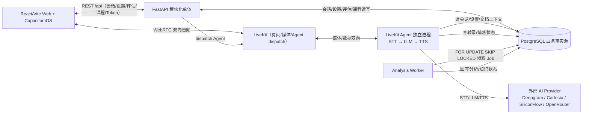

# EchoTalk 概览（技术架构 / 功能 / 使用方法）

> 面向首次接手的开发者兼产品使用者。本文是入口导览；深层契约、长参数表与完整测试流水按文末链接查阅，不在此重复
> README 全文或历史过程。当前事实以 main `d33f236`（SGEC-OFF 已合并 PR194）及实际源码为准；更细的状态与边界见
> [PROJECT_STATUS.md](./PROJECT_STATUS.md) 与 [ARCHITECTURE.md](./ARCHITECTURE.md)。

## 1. 是什么与当前交付状态

EchoTalk 是 AI 英语口语练习平台：选择推荐场景或导入 DocTalk 文本，通过 LiveKit 实时语音练习（练习中实时转录），结束后查看发音与语法反馈、技能掌握度及学习进度。基础轨使用服务端 Provider 配置；自定义轨支持 BYOK（自备密钥），受账号权限与配置验证约束。

- **客户端**：`apps/vite-app` 是唯一交付基线（React 19 + TypeScript + Zustand + Tailwind v4），无 React Router，用
  Zustand 的 `appView` 切换 Dashboard / DocChat 设置 / 语音会话三个顶层视图。
- **iOS**：同一前端的 Capacitor 工程与构建/同步入口；代码存在不等于真机、媒体或分发通过。
- **macOS**：`tools/macos-m1-native-probe` 是 Tauri 2 探测工程，未接入产品 UI；正式桌面工程等设备证据（M2 计划）。
- **后端**：FastAPI 模块化单体 + async SQLAlchemy/Alembic；PostgreSQL 是用户、会话、设置、转录与学习状态的唯一事实源。
- **运行时**：实时语音（LiveKit Agent）与持久化分析（PostgreSQL Job Worker）从 API 进程分离；当前无 Redis/Celery/Chroma
  运行时依赖。
- **外部依赖**：STT/LLM/TTS 是真实外部服务（Deepgram STT、Cartesia TTS、SiliconFlow/OpenRouter LLM）；分析 I1 仍为文本
  demo/synthetic 规则，不是声学发音评分或真实 LLM 语法评估，合成结果不更新真实知识状态。

## 2. 运行时关系图



- **REST 控制面**（会话生命周期、设置、评估查询、课程推荐、取会话 Token）走 `/api`，由 FastAPI 统一处理；会话 Token 由
  API 用 AccessToken 本地签发，不是 API 向 LiveKit 请求 Token。
- **实时媒体与 Agent**：前端与 LiveKit 之间是 WebRTC 双向音频；前端加入房间后由 API dispatch Agent。Agent 独立进程不通过
  FastAPI 依赖注入访问数据库，按房间名中的 `session_id` 读会话/文档上下文/用户设置，选择系统轨或 BYOK，执行
  STT→动态 Prompt/LLM→TTS，并把用户与 Assistant 转录及情感状态写回 PostgreSQL。自定义轨失败时通过 `agent_error`
  DataChannel fail-fast，不静默回退系统密钥。
- **分析 Worker**：结束会话事务创建唯一分析 Job 后立即返回；独立 Worker 用 PostgreSQL `FOR UPDATE SKIP LOCKED` 主动原子
  领取，执行分析、知识状态更新、有限重试与陈旧运行任务恢复，并把分析/知识状态回写 PostgreSQL。

## 3. 仓库地图

```text
apps/vite-app/                React + TypeScript + Zustand，共享产品 UI（Web/iOS）
  src/
    components/               组件（dashboard、doc-chat、conversation、learning、settings、pronunciation）
    data/                     只读查询控制器与数据访问 hooks（进度/语法/活动会话）
    store/                    Zustand：appStore、conversation、settings、navigation、user-state
    lib/                      api.generated.ts（OpenAPI 生成）、agentAnalysis.generated.ts、auth、
                              callLeaseController（通话占用）、诊断、providers.generated.json
    platform/                 平台探测、地址解析、Web/iOS 生命周期适配
  ios/                        Capacitor iOS 工程
backend/                      FastAPI + SQLAlchemy/Alembic
  routers/                    REST 路由（健康、会话、评估、课程、用户设置）
  services/                   分析、BKT 知识追踪、课程与设置、SGEC 离线校验
  livekit_agent/              LiveKit Agent：STT → LLM → TTS
  workers/analysis_worker.py   PostgreSQL 持久化分析任务 Worker
  data/                       版本化离线教学语料（teaching_materials.json）
  scripts/                    seed_corpus.py、evaluate_sgec_offline.py
packages/configs/             共享工具配置
tools/macos-m1-native-probe/  可行性认证探针，非正式桌面工程
docs/                        架构、契约与验收资料
```

前端分层与职责：组件经 `data`（只读查询）与 `store`（业务编排）调用手写 `lib/api` HTTP 客户端；`api.generated.ts` 仅提供 HTTP 生成类型，`agentAnalysis.generated.ts` 是另一套同源契约；
`platform` 隔离系统差异（平台探测、地址解析、Web/iOS 生命周期）。设置表单由组件 `useSettingsForm` 负责，不在 `lib`。

- **Dashboard**：活动会话、推荐场景、每日进度、周进度、周语法 Top 3、技能树，以及设置/DocTalk 入口。
- **DocChat 设置**：选择 `.txt/.md/.markdown` 文本文件（浏览器端 FileReader 读取，正文最多 50,000 字符，原文随会话保存到 PostgreSQL `session_contexts`），可附自定义 Prompt。
- **语音会话（VoiceInterface）**：按会话 `phase` 选择状态视图；`RoomSession` 持有 LiveKit Room 资源与调度，
  `ActiveConversation` 负责对话 UI 并监听 `agent_error`。

## 4. 功能状态表

| 能力            | 状态                 | 事实边界                                                                                                        |
| --------------- | -------------------- | --------------------------------------------------------------------------------------------------------------- |
| Web 客户端      | 已实现               | 交付基线；无 Router，appView 三视图                                                                             |
| iOS             | 基础接入             | Capacitor 工程/麦克风/前后台适配存在；真机全链路与发布未验证                                                    |
| macOS           | 仅探针               | 独立 Tauri 探测，未接产品 UI                                                                                    |
| API             | 已实现               | FastAPI 模块化单体，统一 `/api`                                                                                 |
| 实时语音        | 已实现               | LiveKit + 独立 Agent；真实语音质量不由 CI 证明                                                                  |
| 鉴权            | 已实现               | `AUTH_MODE=dev` 显式 token；`oidc` 校验 issuer/audience/JWKS 并按 (issuer,subject) 隔离；真实 IdP 未验收        |
| BYOK            | 已实现               | Fernet 加密入库；版本化 keyring；免费账号默认自定义轨且不能关闭                                                 |
| 评估/BKT        | 已实现               | 文本 demo/synthetic 规则；合成不更新真实知识状态                                                                |
| 课程检索        | 已实现               | 版本化 JSON 按 CEFR/技能/priority 确定性排序                                                                    |
| SGEC 离线校验   | 已实现               | 纯离线结构校验 + 合成 fixture CLI，未接 default 分析/DB/API/BKT/events                                          |
| 单端通话占用    | 协议已实现，默认关闭 | `CALL_LEASE_MODE=disabled`；Cloud UI 接管与真实媒体撤销未验收                                                   |
| 周报            | 部分实现             | Dashboard 内最近七天 completed 会话数/按日历史/语法 Top3 已上线；练习时长、掌握度环比、发音趋势、下周重点未实现 |
| B2 学习事件表   | 未实现               | 见 [LEARNING_EVENTS_DESIGN.md](./LEARNING_EVENTS_DESIGN.md) §9                                                  |
| Android/Windows | 未实现               | 已明确后置                                                                                                      |

真实 Provider、LiveKit、IdP、设备、整栈与生产部署仍未验收。

## 5. 使用方法（首次使用者）

### 5.1 登录与首次配置 Provider

- **登录**：本地开发 `AUTH_MODE=dev` 用显式 `DEV_AUTH_TOKEN`；生产 `AUTH_MODE=oidc` 走 OIDC Code+PKCE 登录（本轮未宣称
  真实 IdP 登录已验）。
- 新账号默认 `free` 订阅、自定义模式默认开启（免费用户不能关闭自定义轨）。仅填写服务端 `.env` 不等于该账号可使用基础轨；
  首次练习前须在**设置**界面选 Provider、填 Key、保存并验证。自定义凭据未验证（`custom_unverified`）或配置不完整
  （`custom_incomplete`）会被 readiness 拒绝并给出固定提示；免费账号走系统轨会得到 `permission_denied`。

### 5.2 从场景/DocTalk 到练习

1. 打开 `https://localhost:5173`，信任本地开发证书并授权麦克风。
2. 在 Dashboard 选择推荐场景，或进入 DocTalk 设置上传 `.txt/.md/.markdown` 文本（最多 50,000 字符，可附自定义 Prompt）。
3. 开始练习：前端先 readiness 检查，再创建会话 → 取 LiveKit Token → 加入房间 → dispatch Agent → 进入实时语音。
4. 结束：点击结束先停止本地采音并卸载 Room（清除内存 Token），成功后进入结束反馈视图等待异步分析；end 失败显示待重试。

### 5.3 结束反馈与分析

- 结束成功进入结束反馈视图，轮询并展示发音反馈与技能树；分析失败显示稳定错误码并可显式重试。
- 返回主页需用户点击按钮；服务端分析 Job 异步完成，不自动回首页。
- **转录**：练习过程中有实时转录；Agent 持久化转录并可经详情 API 读取，结束反馈视图不渲染完整历史转录。
- **重要**：当前发音/语法反馈是文本 demo/synthetic 规则输出，不是真实声学评分或 LLM 语法评估，也不会提升真实掌握度。

### 5.4 周概览

Dashboard 内展示最近七个本地自然日的 completed 会话次数与语法 Top 3，点击日期查看按日只读历史；练习时长、掌握度环比等
指标未实现（无独立「周度学习页」）。

## 6. 开发准备与启动

### 6.1 版本与工具

Node 22、pnpm 10.26.0、Python 3.12（`>=3.12,<3.13`）、uv 0.9.18，以及独立本地 PostgreSQL 15 空库、可达的 LiveKit 与
Provider 服务。不要复用应用/QA/生产/其他 lane 或自动化专用测试库。

### 6.2 冻结安装

从仓库根执行（仅安装依赖）：

```bash
corepack enable pnpm
pnpm install --frozen-lockfile
cd backend
uv sync --frozen --group dev --python 3.12 --no-python-downloads
cd ..
```

根 `.env` 的配置（含备份/条件复制与变量说明）见 [README「冻结安装与配置」](../README.md)。本地 dev 或真实语音涉及的
关键变量按模式配置：`DATABASE_URL`、`AUTH_MODE`（dev 用 `DEV_AUTH_TOKEN`，oidc 用对应 OIDC 配置）、`VITE_AUTH_MODE`、`VITE_DEV_AUTH_TOKEN`、
`CREDENTIAL_ENCRYPTION_KEYS`、`ACTIVE_CREDENTIAL_KEY_VERSION`、`LIVEKIT_URL`、`LIVEKIT_API_KEY`、
`LIVEKIT_API_SECRET`、`DEEPGRAM_API_KEY`、`CARTESIA_API_KEY`、`DEFAULT_LLM_PROVIDER`、`DEFAULT_LLM_MODEL`
（及 `SILICONFLOW_API_KEY` 或 `OPENROUTER_API_KEY`）。凭据只保存在本地，不进入 Git 或日志。

### 6.3 初始化隔离开发库（需人工审查，不给一键起栈）

历史初始迁移含 `DROP ... CASCADE`：**不能对任意现有库直接升级**，有数据时先备份、审查迁移并单独制定方案。仅用于已核实的
隔离空库，在 `backend` 执行 `alembic upgrade head` 与参考数据播种；课程语料用 `python -m scripts.seed_corpus` 校验。
迁移与参考数据播种需要单独授权，不提供会自动改库的一键命令。

### 6.4 四个进程分终端启动

每个新终端均从仓库根进入，再按下面命令执行：

```bash
# 终端一：API，仅监听本机
cd backend
uv run --frozen uvicorn main:app --reload --host 127.0.0.1 --port 8000
```

```bash
# 终端二：语音 Agent（官方入口，先加载根 .env 再验证配置启动 SDK）
cd backend
uv run --frozen python -m livekit_agent dev
```

```bash
# 终端三：持久化分析 Worker
cd backend
uv run --frozen python -m workers.analysis_worker
```

```bash
# 终端四：Vite HTTPS 客户端，默认 127.0.0.1:5173
pnpm dev:vite
```

- Vite 将 `/api` 代理到 `http://localhost:8000`，并按 `LIVEKIT_URL` 配置 `/livekit-ws` 代理。
- 端口/HTTPS：API 默认 127.0.0.1:8000；Vite 默认 127.0.0.1:5173 且 basicSsl 提供 HTTPS；浏览器跨源访问需把
  `https://localhost:5173` 加入后端 `CORS_ORIGINS`（禁止通配符）。

## 7. 无 Key 能验证什么 / SGEC 离线 CLI

- 无 Key 可运行：SGEC 离线结构校验、Mock 自动化（Vitest、Fake API E2E、后端 pytest）；真实语音还需真实 API、LiveKit、
  Provider 与 Agent 注册，不能靠 Mock 开关推定通过。
- Vitest：`cd apps/vite-app && pnpm test`。
- Fake API E2E：`cd apps/vite-app && pnpm test:e2e`（后台自动起 Fake API 与 Vite，端口 4173/18181，不是普通 dev 离线模式）。
- 健康检查：`/api/health` 只表示进程存活（无需认证）；`/api/health/ready` 需认证并返回 503 稳定原因码。匿名 `curl`
  得到 401 不代表服务已死，ready 返回 200 也不证明双向语音可用。
- SGEC 离线 CLI（纯结构校验 + 合成 fixture，不接真实 Provider/DB/API/BKT）：

```bash
cd backend
uv run --frozen python -m scripts.evaluate_sgec_offline   # 默认合成 fixture
```

## 8. 常见排查与进一步阅读

- 无法开始练习：先看 readiness 原因码（`custom_unverified`/`custom_incomplete`/`permission_denied`/`provider_unconfigured`），
  对照设置页是否已选 Provider、填 Key 并验证保存。
- 结束会话后没有反馈：确认分析 Worker 进程已启动；失败 Job 有稳定错误码与显式重试入口。
- 麦克风/证书：本地开发需信任 Vite 自签证书并授权麦克风；仓库内无生产 TLS 入口，真实 HTTPS/WSS 由外层入口终止。
- 进一步阅读：[README](../README.md)（完整启动配置）、[ARCHITECTURE.md](./ARCHITECTURE.md)（运行时与风险）、
  [PROJECT_STATUS.md](./PROJECT_STATUS.md)（当前状态与验证基线）、[TODO.md](../TODO.md)（唯一待办）、
  [CROSS_PLATFORM_ARCHITECTURE.md](./CROSS_PLATFORM_ARCHITECTURE.md)（三端门禁）、
  [FRONTEND_DATA_LAYER_CONTRACT.md](./FRONTEND_DATA_LAYER_CONTRACT.md)（前端 data 层契约）、
  [LEARNING_EVENTS_DESIGN.md](./LEARNING_EVENTS_DESIGN.md)（B2 学习事件表）。
